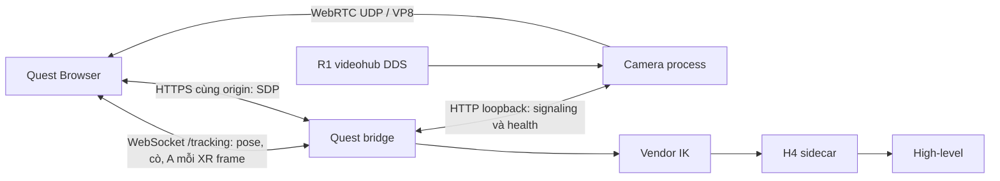

# Quest camera WebRTC và hiệu chuẩn đầu

## Kích hoạt

Từ thư mục `HB` trên máy deploy:

```bash
./deploy_teleop.sh upgrade
```

Lệnh này build bản ARM64 từ source hiện có trên R1, chỉ sửa validator tốc độ
teleop từ 2 lên 4 rad/s. Các object ngoài `Tuning.cpp` phải khớp bản build hiện
có. Preflight dùng bản sao config với `teleop_max_rate_rad_s: 4.0`; không thay
config đang chạy trong bước build. Khi nhập sudo, bước apply yêu cầu trạng thái
DISARMED, idle và status còn mới, lưu backup binary/config rồi khởi động lại
high-level và teleop. Lỗi preflight/start high-level sẽ phục hồi binary/config.
Giới hạn đầu vẫn 1.5 rad/s; mức 4 áp dụng giới hạn tốc độ tay của teleop.

`./deploy_teleop.sh runtime` cập nhật video/đầu và chỉ restart teleop, không
apply mức 4. `rate-stage` chỉ build/preflight bản ứng viên. SSH tự tìm Ethernet,
Wi-Fi hoặc Tailscale; đường SSH độc lập với mạng Quest.

Sau kích hoạt, mở link Quest hiện tại, ENTER VR, bật quyền teleop bằng R3 theo
flow hiện có, giữ cò phải để điều khiển. Bấm A phải đổi camera robot/passthrough.
Lần đầu sau hiệu chuẩn, giữ đầu ở tư thế muốn dùng làm trung tính.

## Kiến trúc



Video dùng process và lõi CPU riêng khi có ít nhất 5 lõi; không đưa JPEG vào
WebSocket điều khiển. HTTP media chỉ lắng nghe loopback; `/camera/offer` được
proxy qua HTTPS có sẵn. Trình duyệt nhận WebRTCVideoPlane; không mở thêm URL,
certificate hay dịch vụ Internet. ICE chỉ quảng bá IPv4 Wi-Fi của R1; không
STUN/TURN. Mạng phải cho Quest tới TCP 8012 và UDP của robot, không client
isolation. UFW active được bổ sung rule UDP ephemeral chỉ cho subnet/interface
Quest lúc deploy. Đổi Wi-Fi thì chạy lại `runtime` để cập nhật cert và firewall;
không đổi `camera_interface: eth10` nếu interface DDS nội bộ không đổi.

## FPS và ảnh cũ

`robot_runtime.camera_capture_hz: 0` bật tự điều chỉnh, bắt đầu 12 FPS. Ba cửa
sổ 1 giây khỏe liên tiếp cho phép tăng FPS. Trần được đo từ thời gian RPC/decode
và encode/send, không cố định 6 hoặc 30 FPS. WebRTC đổi bitrate theo REMB;
policy giảm độ phân giải trước khi giảm FPS khi RTT/mất gói/budget cho thấy
nghẽn. Budget thấp lúc khởi động không tự coi là nghẽn; vượt budget cần lặp
hai cửa sổ. Giá trị `camera_capture_hz` dương là giới hạn do người dùng chọn.

Chỉ giữ ảnh mới nhất; không tích hàng đợi. JPEG thiếu phần kết/truncated bị
loại, ghi lỗi. `target_fps` là nhịp yêu cầu, không phải FPS ảnh mới thật; source
có thể trả JPEG trùng hoặc hỏng. Khi passthrough, dừng fetch/decode và đóng
peer. Lần đầu bật A chờ tối đa 5 giây cho DDS khởi tạo; ảnh được chấp nhận phải
còn mới ≤0.5 giây. Ảnh cũ >1 giây hoặc peer không kết nối được sau 8 giây đưa
về passthrough. Đường điều khiển không phụ thuộc encoder video.

## Đầu và dữ liệu cò

Wrapper đã đổi OpenXR sang hệ tọa độ robot. Góc đầu dùng `R_neutral.T @ R_now`
rồi trích góc theo thứ tự khớp thật `Ry(pitch) @ Rz(yaw)`. Trừ hai góc Euler
thế giới như trước có thể đảo yaw khi heading vượt 90° và tạo pitch giả.
Phép trích góc hiện dùng `atan2` và chọn nhánh theo dấu trục forward X, giữ
đúng yaw tới giới hạn URDF ±115°; không còn gập yaw 100° thành 80°. Tại đúng
±90°, pitch không xác định được từ hướng nhìn, nên giữ pitch trước đó trong
calibrator. Không đảo dấu motor hay đổi basis thêm lần nữa.

Bootstrap `xr-frame-v3` được chèn trực tiếp trước frontend Vuer trong HTTPS
index (`Cache-Control: no-store`). Nó quan sát `XRFrame.getViewerPose` mà renderer
đang gọi, lấy viewer pose và controller target-ray pose của tay còn tracking trong **cùng reference
space của renderer**, đọc cò/A trong cùng frame và gửi tối đa 30 mẫu/s qua
`/tracking` cùng origin. Không còn phụ thuộc việc hook `requestSession` chạy
đúng lúc. Tay phải phải có pose/cò mới; tay trái có thể vắng mặt. Pose đứng yên vẫn là quan sát mới; không dùng timer gia hạn pose cũ.
URL Quest không đổi. Sau khi restart runtime, đóng phiên VR/tab cũ và mở lại
trang để chạy bootstrap mới; thao tác này không tự chứng minh lỗi đã được sửa.

Ngưỡng cò trên dữ liệu OpenXR [0,1]: nhấn từ 0,5 trở lên; sau khi nhấn, chỉ nhả
khi xuống 0,15 hoặc thấp hơn. Dao động hợp lệ 0,2–0,49 không tự STOP; nhả hoàn
toàn về 0 vẫn STOP ngay. Gate áp dụng đồng thời cho digital/analog để vendor
không thể vượt gate qua đường analog. Không giữ enabled khi input thiếu/sai.

Chỉ một socket tracking giữ quyền ghi pose/cò. Phiên thứ hai nhận HTTP 409 khi
phiên đầu còn fresh; phiên đầu stale >0,5s có thể được thay thế. Đóng socket cũ
không được nhả cò của chủ mới. Mỗi lần đổi phiên phải thả cả hai cò để rearm.
Các event controller/head legacy của Vuer bị bỏ qua để tránh ghi đè snapshot.

### Chỉ dùng tay cầm phải

`arm_tracking` đi xuyên suốt bridge → IK → mapper → H4 sidecar. Khi tay trái
mất input source/pose/gamepad, frame vẫn hợp lệ nếu đầu và tay phải còn fresh.
Tay phải tiếp tục điều khiển; tay trái bị đánh dấu inactive và không được dùng
pose cũ như một quan sát mới. IK tạo target FK của model cho effector inactive
để tiếp tục gọi vendor solve mới cho từng mẫu tay phải. Sidecar bỏ hoàn toàn
các giá trị IK của tay trái inactive: lấy 5 encoder trái từ lowstate mới tại
thời điểm mất tracking rồi giữ hằng các khớp đó. Không cho target giữ chạy
đuổi theo encoder mỗi tick.

Tay trái trở lại khi cò phải đang giữ vẫn inactive. Thả rồi nhấn cò phải để
bắt đầu phiên có tay trái lại; không tự nhảy sang target vừa tái xuất hiện.
Nếu trái đã vắng ngay từ đầu, thả cò phải là đủ để rearm. Mất tay phải/đầu,
phiên VR ẩn hay mất socket vẫn STOP cả phiên. Cò thật về 0 vẫn STOP ngay.
Mặt nạ inactive chỉ được hỗ trợ ở H4; mapper từ chối nó trên route legacy hoặc
khi IK không xác nhận cùng mặt nạ. UTL1/high-level C++ không đổi wire format.


Bridge dùng thời gian nhận snapshot, không dùng việc pose đổi để quyết định
stale. Mất snapshot >0,5s, pose đầu/tay phải không hợp lệ, session ẩn/kết thúc hoặc socket
mất kết nối phát STOP liên tục. Sau mất tracking/kết nối, cần thả cả hai cò rồi
giữ cò phải lại. Socket có backlog lớn sẽ đóng, không xếp hàng pose cũ. IK vẫn
solve mới cho mỗi mẫu enabled, không đổi contract H4.

Bootstrap báo boot/installed/connected/ready/invalid/socket_closed/ended cùng
lý do tracking mất qua POST `/tracking/diagnostic`. GET `/tracking/status`
trả protocol, trạng thái browser gần nhất, sequence, tuổi dữ liệu và rearm.
Deploy kiểm tra route này và protocol v2 trước khi báo runtime sẵn sàng.
**Runtime sẵn sàng không đồng nghĩa Quest đã gửi tracking**: sau ENTER VR cần
`tracking_frames_seen=true`, sequence tăng và age còn fresh. Khi lỗi phải đọc
lý do cụ thể, không mặc định lỗi cache hay camera.

Log `bridge_connection.jsonl` lưu sequence, age, validity của snapshot,
`tracking_requires_release`, giá trị cò phải gốc trước gate, timing events và presence,
validity, giá trị cò gốc [0,1], và trạng thái cò sau wrapper [10,0]. Thiếu/không
hợp lệ thì nhả, không giữ trạng thái cò cũ. Không dùng event nhận được như
heartbeat để gia hạn nghiệm IK cũ. Watchdog source/lowstate và high-level vẫn
là đường quyết định quyền điều khiển.

`camera_webrtc.jsonl` ghi FPS mục tiêu, thời gian capture, bitrate, RTT, loss,
ảnh trùng/hỏng và lỗi capture gần nhất. Một ảnh hỏng hoặc video gap không đủ
để kết luận camera gây nhả cò; cần ghép timestamp với log điều khiển/sidecar.

## Kết quả kiểm tra 2026-10-08

- 88 test đạt trong môi trường có aiortc; gồm truyền video loopback, đóng/mở
  hai phiên, không capture khi idle, neutral nhiều heading, thích nghi FPS và
  trigger thiếu/không hợp lệ. Interpreter tối thiểu bỏ qua test cần aiortc.
- R1 ARM64: endpoint HTTPS thử 8512 proxy sang media loopback 8513; camera DDS
  thật, WebSocket controller giả lập 30 Hz, không chạy sidecar/IK/motor.
- A bật/tắt và mở lại camera thành công hai vòng; 558 frame/35s và 109 frame/8s
  nhận tại peer thử (khoảng 16 và 14 FPS), 640×360. Gap video tối đa khoảng
  0.66s; gap CONTROLLER_MOVE tối đa 0.0473s. Thiếu field cò có chủ ý tạo STOP
  rồi khôi phục khi dữ liệu trở lại.
- Source vẫn có JPEG hỏng và trùng (40 lỗi capture trong phiên thử); tách
  transport không sửa nguồn videohub. Policy/log giúp thấy giới hạn này.
- Sau lần `upgrade` của người dùng, đã xác nhận hash binary live khớp candidate
  ARM64 và rate 4 được áp dụng. Snapshot high-level hiện DISARMED, idle.
- Cần acceptance trên Quest thật: giữ cò với camera ≥2 phút, đổi A nhiều lần,
  kiểm tra yaw/pitch và chuyển động tay. Kiểm tra loopback không chứng minh
  lỗi nhả cò trên Quest đã hết hoặc chấp nhận chuyển động cơ khí.


## Sửa liveness, shutdown và báo lỗi camera (2026-10-08)

- 134 regression test đạt trong môi trường có aiortc, logging-mp và QuickJS.
  Gồm chạy JavaScript thật với WebXR stub, stationary snapshots, mất pose,
  session ẩn, socket backlog, yaw ±100/110/120°, SIGTERM logging child thật,
  và report deploy trên pseudo-terminal (màu đỏ/mã 2/InvocationID).
- Bài thử tách biệt trên R1 với camera DDS thật: giữ pose/cò cố định 120s,
  3439 enabled command trong cửa sổ đo, gap command tối đa 0.0408s. Nhận
  631 frame video trong 35s; A trả về passthrough. Invalid tracking phát STOP,
  phải release rồi press mới re-arm; đóng socket cũng STOP. Không chạy sidecar
  hoặc ghi motor trong bài thử này; đây chưa phải acceptance Quest/cơ khí.
- IK cài handler SIGTERM để chạy finally/atexit, đóng queue logging-mp và join
  listener; nếu listener không thoát thì kill riêng child đó sau timeout ngắn.
  Không sửa vendor logging-mp hoặc giảm timeout systemd để che lỗi. Bài thử
  R1 với solver vendor thật, stdin idle: SIGTERM thoát 0.465s và listener con
  không còn trong /proc. Lần restart đầu có thể vẫn phải chờ tiến trình cũ;
  các lần sau mới dùng handler đã sửa.
- Camera preflight thử tối đa ba mẫu trong timeout 8s, giữ lỗi RPC/JPEG thực tế.
  Camera lỗi không chặn teleop tay/đầu trong passthrough: service báo
  `READY_WITH_CAMERA_ERROR`; deploy in đỏ `DEPLOY DEGRADED` và trả mã 2 sau
  khi in URL. Lỗi runtime/install chặn chức năng vẫn trả mã khác 0 và báo đỏ.
  Khi chủ động tắt camera, deploy đọc cấu hình thực tế trong runtime.env.
- Deploy chỉ đọc journal theo InvocationID hiện tại. Không lấy WARN của lần
  chạy cũ, không coi signaling sẵn sàng là media đã hiển thị trên Quest.
- Ba sửa lỗi này chỉ cần `./deploy_teleop.sh runtime`; không cần build lại
  high-level bằng `upgrade` nếu mức 4 rad/s đã được áp dụng. Cần reload trang
  trên Quest để nạp tracking script mới rồi thử lại flow R3/cò/A.

Trạng thái triển khai: sau khi sửa auth/test deploy, đã chạy
`./deploy_teleop.sh runtime` thành công qua Tailscale, exit 0. WebXR/H4 ACTIVE,
camera nguồn giải mã ảnh thành công và service chính đã nạp bản sửa.
Reload trang Quest để nạp JavaScript tracking mới trước khi ENTER VR.

## Lỗi xác thực và regression deploy (2026-10-08)

- Test report camera đã khai báo `SSH=(ssh)` để dùng đúng mock khi script dùng
  mảng SSH. Lỗi test local được kiểm tra trước SSH/sudo; không hỏi mật khẩu
  rồi mới phát hiện test fail.
- SSH master mở bằng phiên `true` với `-f`, thay cho `-MNf`; đã tái hiện
  thông báo `Master refused session request: Permission denied` với cách cũ
  và xác nhận cách mới dùng lại được cùng master.
- Cài và kiểm tra rule `timestamp_type=global` trong một tiến trình root đã
  xác thực. Không chạy các sudo lồng sau khi đổi loại cache. Nếu lần thiết lập
  đầu cần xác thực lại cache mới, hỏi ngay trong cùng lệnh, không abort rồi
  bắt chạy lại. Rule đã có thì chỉ cần xác thực sudo thông thường khi hết hạn.
- Xác nhận sudo cache dùng được qua SSH channel khác trước khi deploy; cleanup
  SSH master và keepalive cả khi auth fail. Dọn cả sleep child khi dừng keepalive.
- Test migration tty -> global dùng sudo/SSH mock, không thay policy thật trên
  máy chạy test. Môi trường đầy đủ: 136 test đạt; interpreter hệ thống:
  133 đạt, 3 skip do thiếu dependency test tùy chọn.


## Bản sửa tracking v2 — kiểm tra hiện tại

- 140 test đạt trong môi trường đầy đủ, gồm bootstrap WebXR xuất hiện muộn,
  `requestSession` không thể ghi đè, pose đứng yên, dữ liệu thiếu/emulated,
  hysteresis cò, HTTP/WS routes thật, quyền sở hữu phiên, STOP và rearm.
- Kiểm tra server/khung XR giả lập không thay thế nghiệm thu Quest thực tế.
- Nghiệm thu trên Quest: giữ cò ít nhất 2 phút trong passthrough, sau đó camera
  robot; lặp A ít nhất 10 vòng. Đối chiếu browser reason, frame sequence/age,
  bridge deadman, mapper/sidecar và camera health. Nếu Quest mất inputSources
  hay pose thật, phải xử lý nguyên nhân browser/controller; không tăng watchdog
  để tiếp tục điều khiển từ pose cũ.

## Bản sửa dùng tay phải độc lập — 2026-10-08

- 146 test đạt trong môi trường đầy đủ; preflight tối thiểu đạt 141, bỏ qua
  5 test cần dependency tùy chọn. Bao gồm encoder hold 2 phút, tay trái mất/trở
  lại, khởi tạo chỉ có tay phải, mặt nạ sai, FK inactive và fresh solve.
- IK vendor thật trên R1: 5 lần solve mới, FK inactive đúng, 10 khớp finite,
  không mở transport robot/phát lệnh motor. Kết quả thời gian khoảng 81ms/5 lần
  của test này không phải độ trễ của toàn bộ teleop thật.
- Kênh v2 đã xác nhận trên Quest thật; v3 đã nạp lên R1 lúc 17:27 ngày
  2026-10-08 và cần nghiệm thu lại chế độ chỉ dùng tay phải trên kính. Kiểm tra code, server giả lập và kính thật là các bước khác nhau.

- Phép thử right-only cô lập trên R1: 120,107 giây, 3.349 lệnh enabled, gap lớn
  nhất 37,6ms. Chuỗi IK thật → mapper → H4 với encoder mô phỏng: 112 target
  enabled, tay trái giữ 0,4rad. Không mở DDS/UDP/motor trong phép thử chuỗi này.
